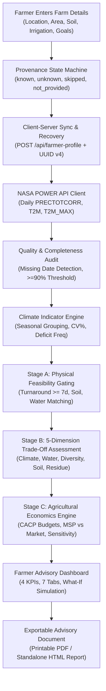

# Sproutnik

**Climate-Aware Crop Rotation Intelligence & Agronomic Decision Support for Sustainable Agriculture**

[](https://nextjs.org/)
[](https://react.dev/)
[](https://www.typescriptlang.org/)
[](https://tailwindcss.com/)
[](https://vitest.dev/)
[](https://power.larc.nasa.gov/)
[](https://pau.edu/)

---

## 1. Project Title & Branding

**Sproutnik** (internally designated as *Rotation Compass*) is an open-source, full-stack agricultural intelligence platform engineered for the **NASA Space Apps Challenge 2026**.

Sproutnik bridges the gap between planetary satellite observations and ground-level farming decisions. By pairing 10-year daily historical meteorological data from the **NASA POWER** satellite reanalysis with peer-reviewed agro-ecological research from **Punjab Agricultural University (PAU)**, hydrological assessments from the **Central Ground Water Board (CGWB)**, and farm economic benchmarks from the **Commission for Agricultural Costs and Prices (CACP)**, Sproutnik provides transparent, multi-dimensional crop rotation recommendations designed to arrest catastrophic groundwater depletion in northwest India.

---

## 2. Overview

### What Sproutnik Is
Sproutnik is an evidence-based decision-support system built for growers, agricultural extension workers (Krishi Vigyan Kendras), and rural policy planners. Prototyped for the intensive Rice–Wheat alluvial plains of **Ludhiana District, Punjab, India** (30.90° N, 75.85° E) and extensible across northwest India, the platform analyzes a farm's exact location, operational landholding, soil texture, and irrigation infrastructure to evaluate candidate crop rotations against the dominant puddled rice monoculture.

### The Agricultural Problem It Addresses
For over five decades since the Green Revolution, the Indo-Gangetic Plains have operated under a high-intensity, flood-irrigated Rice–Wheat cropping cycle. While this system secured national food reserves, it has triggered severe ecological degradation:
- **Groundwater Extraction Crisis:** Punjab's statewide Stage of Ground Water Extraction (SOE) stands at **164%**, with more than **76% of assessment units categorized as "Over-Exploited"** by the Central Ground Water Board (CGWB). In central districts like Ludhiana, Patiala, and Sangrur, the water table recedes by 0.5 to 1.0 meter annually, forcing farmers to deepen submersible tubewells at mounting financial cost.
- **Physical Soil Degradation:** Continuous puddling for transplanted rice destroys soil macropores, creating an impermeable subsoil hardpan at 15–20 cm depth that restricts root aeration and water infiltration for subsequent winter wheat.
- **Climate Vulnerability & Residue Bottlenecks:** Late-maturing paddy varieties vacate fields in late October or early November, leaving a narrow 10–20 day window before optimal wheat sowing. Delays past November 15 expose the wheat crop to March terminal heatwaves (>30°C), curtailing grain fill by 150–200 kg/ha per week of delay. This narrow turnaround historically incentivized in-field paddy stubble burning.

### Why the Solution Matters
Conventional agricultural advisories often promote alternative crops in isolation without evaluating:
1. Physical calendar turnaround viability between harvest and subsequent sowing.
2. Soil texture suitability (e.g., preventing Direct-Seeded Rice on coarse sandy soils prone to severe iron chlorosis).
3. Real-world financial trade-offs against guaranteed Minimum Support Price (MSP) public procurement.

Sproutnik replaces generalized advice with a transparent, multi-stage engineering pipeline:
- **Zero Black-Box Scoring:** Every recommendation is backed by documented agronomic evidence, physical units (mm/year, ₹/ha, turnaround days), and explicit risk disclosures.
- **Radical Data Truthfulness:** Distinguishes measured NASA observations from regional fallbacks, preserves farmer uncertainty (`known`, `unknown`, `skipped`, `not_provided`), and avoids fabricated real-time claims.

---

## 3. Problem Statement

```
+--------------------------------------------------------------------------------------------------+
|                                    THE PUNJAB CROPPING PARADOX                                   |
|                                                                                                  |
|   Puddled Rice (Kharif)                  Turnaround Bottleneck             Rabi Wheat            |
|   1,500 - 2,000 mm Water                 10 - 20 Day Window                400 mm Water          |
|   + Impermeable Hardpan                  + Stubble Burning Pressure        + March Terminal Heat |
|                                                                                                  |
|   Result: Aquifer Overdraft (164% SOE) | Soil Compaction | Terminal Heat Yield Losses | Pollution|
+--------------------------------------------------------------------------------------------------+
```

1. **Severe Groundwater Depletion:** Flood-irrigated puddled rice requires 1,500–2,000 mm of water in a region receiving ~680 mm of mean annual rainfall. Deep submersible tubewells extract groundwater far in excess of natural monsoon recharge.
2. **Soil Structural Damage:** Repeated puddling breaks down soil aggregates and creates an impermeable layer that impedes root elongation, drainage, and nutrient uptake.
3. **Narrow Turnaround & Air Quality:** The short window between rice harvest and wheat planting creates severe labor and equipment bottlenecks, historically driving widespread stubble burning.
4. **Terminal Heat Stress Under Climate Change:** NASA POWER records show increasing March maximum temperatures exceeding critical crop thresholds (>30°C), penalizing late-sown wheat.
5. **Economic Risk & Price Volatility:** While paddy and wheat enjoy near-100% government procurement at MSP in Punjab mandis, alternative crops (such as maize, summer pulses, and oilseeds) face price discounts in open markets, discouraging voluntary diversification.

---

## 4. Our Solution

Sproutnik provides a comprehensive, three-stage analytical framework that equips farmers and extension officers with the data required to transition toward sustainable, climate-resilient crop rotations:

```
+--------------------------------------------------------------------------------------------------+
|                                  SPROUTNIK THREE-STAGE ENGINE                                    |
|                                                                                                  |
|   Stage A: Physical Agronomic Feasibility Gating                                                 |
|   Checks turnaround gaps (>= 7 days), soil texture matching, irrigation feasibility,             |
|   and preceding crop allelopathic compatibility.                                                 |
|                                     |                                                            |
|                                     v                                                            |
|   Stage B: 5-Dimension Trade-Off Assessment                                                      |
|   1. Climate & Thermal Risk       2. Water Demand & Aquifer Impact   3. Agrobiodiversity         |
|   4. Soil Health & N-Cycling      5. Turnaround & Residue Management                             |
|                                     |                                                            |
|                                     v                                                            |
|   Stage C: Agricultural Economic Intelligence                                                     |
|   CACP cost of cultivation budgets, verified MSP benchmarks, byproduct values,                  |
|   biological nitrogen credits, pumping energy adjustments, and 3-scenario sensitivity.          |
+--------------------------------------------------------------------------------------------------+
```

- **Stage A — Physical Feasibility Gating:** Candidate rotations are filtered against physical constraints before ranking. For example, Direct-Seeded Rice (DSR) is rejected on coarse sandy soils due to high percolation and iron chlorosis, and rotations with turnaround gaps under 7 days are eliminated.
- **Stage B — Multi-Dimensional Trade-Offs:** Rather than reducing complex ecological decisions to an arbitrary single score, Sproutnik evaluates five separate agronomic dimensions: climate compatibility, groundwater pressure, biological diversity, soil restoration, and residue management.
- **Stage C — Economic Viability & Sensitivity:** Evaluates gross revenue, operational cultivation costs (A2 + FL proxy), net returns per hectare, and Benefit-Cost Ratios (BCR) based on CACP price policy benchmarks and Punjab mandi arrivals.
- **Interactive "What-If" Exploration:** Allows farmers to simulate changes in soil texture and irrigation sources in-memory to immediately view the impact on crop feasibility and profitability without modifying saved profile records.
- **Printable Advisory Reports:** Generates professional, offline-ready advisory documents complete with seasonal crop calendars, itemized cost breakdowns, and practical on-farm planting checklists.

---

## 5. Key Features

### 1. Farmer Onboarding & Profile Management
- **Provenance-Aware Multi-State Tracking (`ProfileField`):** Every profile attribute explicitly maintains one of four states:
  - `known`: Confirmed by user input with source metadata.
  - `unknown`: Explicitly chosen by the farmer as "I'm not sure".
  - `skipped`: Explicitly bypassed by the farmer without penalty.
  - `not_provided`: Not yet encountered or supplied.
- **Zero-Penalty Uncertainty:** Fallback regional baselines (e.g., Punjab average 5.0-acre operational holding, central alluvial loam soil) are clearly separated from farmer-reported facts.
- **Dual Onboarding Experiences:**
  - *Guided Field Guide:* A structured 7-step visual workflow covering Location, Land Area, Soil Texture, Water Sources, Current Crops, Farming Goals, and Profile Audit.
  - *Conversational Mode:* A natural dialogue interface with suggestion chips, direct text entry, and a live synchronized workspace context sidebar.
- **Regional Land Unit Conversions:** Seamlessly handles statutory Punjab Kanals (1 Acre = 8 Kanals), traditional Punjab Kacha Bighas (1 Acre ≈ 4.8 Bighas), standard English Acres, and metric Hectares.
- **30/70 Interactive Split Workspace:** A dedicated left-side control panel with an interactive high-resolution agricultural satellite map on the right, featuring HTML5 Geolocation, coordinate adjustment, and offline vector fallback.
- **Localization Architecture:** Native content dictionaries supporting English (`en`), Punjabi (`pa`, Gurmukhi script), and Hindi (`hi`, Devanagari script).

### 2. Resilient Client-Server Lifecycle & Persistence
- **Client Cache (`sproutnik:farmer-profile:v1`):** Versioned, safe `localStorage` caching preventing unhandled quota or availability exceptions.
- **Automatic 404 Recovery with Identity Rotation:** If the server-side in-memory store is reset (e.g., during development or server restart), the client detects the missing profile, transparently re-registers it via `POST /api/farmer-profile`, and rotates the profile UUID without losing user state.
- **Route Protection (`DashboardGate`):** Unauthenticated visitors can explore the system immediately via a one-click Demonstration Mode (`?demo=true`) based on Ludhiana reference data.

### 3. Climate Intelligence Subsystem
- **Direct NASA POWER Integration:** Fetches daily surface meteorological observations from the NASA POWER Daily Point API (`PRECTOTCORR`, `T2M`, `T2M_MAX`) for any coordinates.
- **Data Quality & Completeness Auditing:** Rigorously detects missing dates and enforces a 90% observation completeness threshold for annual and seasonal calculations.
- **Punjab Agricultural Seasonal Grouping:** Groups observations according to natural cropping windows rather than standard calendar years:
  - *Winter (Rabi):* November through February (spanning across calendar year boundaries).
  - *Summer (Zaid):* March through May.
  - *Monsoon (Kharif):* June through September.
  - *Post-Monsoon Transition:* October.
- **Statistical Climate Indicators:** Calculates 2-stage equal-weighted climatological means, interannual rainfall Coefficient of Variation (CV%), and historical 7-month dry-season deficit frequency.
- **Calibrated Offline Mock:** Supports zero-latency offline development and demonstration via `&mock=true`.

### 4. Crop Rotation & Recommendation Engine
- **Engine-Evaluated Rotations:** Evaluates five primary cropping rotations against regional baselines:
  1. *Rice–Wheat (Baseline Monoculture):* Conventional puddled transplanting followed by bread wheat (~2,150 mm total irrigation demand).
  2. *Direct-Seeded Rice (DSR) – Wheat:* Mechanized dry seeding on non-puddled soil (~1,800 mm irrigation demand, saves 15–20% water).
  3. *Kharif Maize – Wheat (Diversified Cereal):* Replaces kharif rice with grain maize (~900 mm irrigation demand, saves 60–65% water).
  4. *Rice – Wheat – Summer Moong (Legume Intensified):* Triple cropping incorporating a 60-day summer catch pulse fixing 30–40 kg N/ha.
  5. *Maize – Mustard – Summer Moong (High Diversity):* Fully diversified cereal–oilseed–pulse rotation eliminating flooded paddy (~1,030 mm irrigation demand).
- **Objective Head-to-Head Comparison:** Direct pairwise evaluation between any two rotations (`compareTwoRotations`) contrasting water savings, turnaround flexibility, feasibility differences, and net return deltas.

### 5. Agricultural Economic Intelligence
- **Cost of Cultivation Modeling:** Grounded in CACP 2024–25 price policies and PAU farm management studies, breaking down seeds, fertilizers, plant protection, machinery/labor, irrigation pumping energy, and miscellaneous costs.
- **Contextual Energy & Soil Cost Adjustments:** Pumping energy costs adjust dynamically for deep tubewells, shallow tubewells (with suction penalties for water tables >15 m), canal supplies, and rainfed setups; soil-specific adjustments account for fertilizer leaching in sandy soils or ridge-sowing machinery in clay loams.
- **Byproduct & Ecological Value Credits:** Accounts for secondary economic streams including wheat straw (*bhusa/turi*, ~₹12,000/ha) and biological atmospheric nitrogen fixation from summer moong (~₹1,400/ha fertilizer savings).
- **Sensitivity & Scenario Projections:** Models financial returns under conservative, reference, and optimistic scenarios, alongside sensitivity analyses across yield, price, and input cost variations (±10%, ±20%).

### 6. Farmer Dashboard & Reporting
- **Executive Metric Strip:** Displays the four most critical farm metrics: Baseline Water Demand, Recommended Water Demand, Expected Net Return, and Agronomic Feasibility Status.
- **7 Detailed Insight Tabs:**
  - *Rotations:* Candidate overview, sequence diagrams, and turnaround intervals.
  - *Water:* Aquifer impact, water table drawdown, and irrigation requirements.
  - *Climate:* NASA POWER rainfall and temperature trends, CV%, and seasonal distribution.
  - *Economics:* Itemized crop budgets, net returns, BCR, and baseline comparisons.
  - *Soil:* Hardpan mitigation, nutrient balance, and texture suitability.
  - *What-If Scenario:* Live in-memory sandbox for simulating soil and irrigation adjustments.
  - *Methodology:* Transparent documentation of data provenance, formulas, and assumptions.
- **Farmer Advisory Report Generator:** Printable and exportable HTML advisory documents with custom styling, verified QR codes, seasonal task checklists, and extension disclaimers.

---

## 6. How It Works



1. **Farm Specification:** The grower defines their operational holding through the guided Field Guide or Conversational Assistant. Land units (Kanals, Bighas, Acres, Hectares) are normalized to metric Hectares.
2. **Environmental Retrieval:** The backend queries the NASA POWER API for the farm's exact coordinates across a 10-year historical window (2015–2024), retrieving daily precipitation and temperature readings.
3. **Data Quality Verification:** Missing dates and fill values (`-999`) are audited. Years with less than 90% completeness are excluded from multi-year baselines, and seasonal series are validated independently.
4. **Agronomic Feasibility Evaluation:** The engine runs candidate crop sequences through Stage A feasibility rules:
   - Are turnaround intervals between consecutive crops $\ge 7$ days?
   - Can the farm's water source sustain the rotation's peak seasonal requirement?
   - Is the soil texture agronomically compatible with every crop in the sequence?
   - Are preceding crops compatible without disease or allelopathic inhibition?
5. **Trade-Off Modeling:** Feasible alternatives are evaluated against the Rice–Wheat baseline across five key environmental and operational dimensions.
6. **Economic Valuation:** Crop-level economic benchmarks compute operational expenditure, gross revenue, and net margins, applying adjustments for irrigation pumping depth and soil management.
7. **Actionable Presentation:** The farmer inspects recommendations on the interactive dashboard, experiments with alternate scenarios in the What-If sandbox, and exports an official advisory report.

---

## 7. Technology Stack

| Layer | Technology | Version | Purpose & Architectural Role |
| :--- | :--- | :--- | :--- |
| **Framework** | Next.js (App Router) | `15.5.29` | Full-stack architecture, React Server Components, Route Handlers, and client hydration. |
| **UI Library** | React | `19.2.9` | Declarative user interfaces, hooks, and responsive view rendering. |
| **Language** | TypeScript | `5.6.3` | End-to-end type safety, discriminated union domain modeling, and strict contract enforcement. |
| **Styling** | Tailwind CSS | `3.4.15` | Utility-first responsive design, custom agricultural design system tokens, and mobile-native spacing. |
| **CSS Processing** | PostCSS / Autoprefixer | `8.5.32` / `10.4.20` | Cross-browser CSS transformations and vendor prefixing. |
| **Testing** | Vitest | `5.1.0` | High-performance unit, integration, and live API test execution (26 test files, 302 tests). |
| **Client Storage** | Browser `localStorage` | HTML5 Standard | Versioned profile envelope caching (`sproutnik:farmer-profile:v1`) with quota-safe wrappers. |
| **Server Persistence** | In-Memory Repository | Node.js Runtime | Ephemeral `globalThis` singleton store surviving Next.js development HMR cycles. |
| **External APIs** | NASA POWER Daily Point API | REST / JSON | Authoritative satellite and assimilation solar, temperature, and precipitation data. |
| **Icons** | Custom SVG Components | In-House | Domain-specific agricultural, meteorological, and system navigation iconography. |

---

## 8. Data Sources & Integrations

Sproutnik strictly distinguishes between **live external APIs**, **static agronomic datasets**, and **locally computed indicators**.

```
+--------------------------------------------------------------------------------------------------+
|                                    DATA PROVENANCE MATRIX                                        |
|                                                                                                  |
|   Source                           Type         Parameters / References                          |
|   -------------------------------  -----------  -----------------------------------------------  |
|   NASA POWER Daily Point API       Live API     PRECTOTCORR, T2M, T2M_MAX (0.5° x 0.5° grid)     |
|   Punjab Agricultural University   Static Data  PAU Kharif, Rabi & Zaid Packages of Practices    |
|   Central Ground Water Board       Static Data  Dynamic Ground Water Resources Assessment (2023) |
|   CACP (Govt. of India)            Static Data  Price Policy for Kharif & Rabi Crops (2024-25)   |
|   Sproutnik Analytics Engine       Calculated   CV%, Deficit Freq, Net Returns, BCR, Deltas      |
+--------------------------------------------------------------------------------------------------+
```

### 1. Live External API: NASA POWER
- **Endpoint:** `https://power.larc.nasa.gov/api/temporal/daily/point`
- **User Community:** Agroclimatology (`AG`)
- **Access Protocol:** Open-access scientific REST API (zero authentication key required).
- **Spatial Resolution:** Global 0.5° latitude $\times$ 0.5° longitude grid cell (~50 km $\times$ 50 km).
- **Parameters Retrieved:**
  - `PRECTOTCORR`: Precipitation Corrected (mm/day).
  - `T2M`: Daily Mean Air Temperature at 2 Meters (°C).
  - `T2M_MAX`: Daily Maximum Air Temperature at 2 Meters (°C).
- **Time Horizon:** 10-year historical observation baseline (2015–2024).

### 2. Verified Static Agronomic Evidence
- **Punjab Agricultural University (PAU), Ludhiana:**
  - *Package of Practices for Kharif Crops of Punjab (2023):* Sowing windows, nursery management, water requirements, and the Punjab Preservation of Subsoil Water Act (2009) regulations.
  - *Package of Practices for Rabi Crops of Punjab (2023):* Optimum wheat sowing dates (Oct 25 – Nov 15), terminal heat sensitivity, and mustard cultivation practices.
  - *PAU Direct-Seeded Rice (DSR) Guidelines (2022):* Water savings, soil texture limits (avoiding light sandy soils), and weed management protocols.
  - *Cultivation of Summer Moong as Catch Crop (2022):* SML-668/832 60-day summer pulse management and atmospheric nitrogen fixation parameters.
- **Central Ground Water Board (CGWB), Ministry of Jal Shakti, Government of India:**
  - *Dynamic Ground Water Resources of Punjab State (2023 Assessment):* Documenting 164% Stage of Ground Water Extraction statewide, over-exploited classifications, and tubewell density in central Punjab.
- **ICAR-Indian Institute of Farming Systems Research (IIFSR):**
  - *Alternative Cropping Systems for Groundwater Conservation in Northwest Indo-Gangetic Plains (2021).*

### 3. Verified Static Economic Benchmarks
- **Commission for Agricultural Costs and Prices (CACP), Ministry of Agriculture & Farmers Welfare, GoI:**
  - *Price Policy for Kharif Crops (2024-25 Marketing Season):* MSP benchmarks for Common Paddy (₹2,300/q), Kharif Maize (₹2,225/q), and Summer Moong (₹8,682/q).
  - *Price Policy for Rabi Crops (2024-25 Marketing Season):* MSP benchmarks for Bread Wheat (₹2,275/q) and Rabi Mustard/Raya (₹5,650/q).
  - *Cost of Cultivation Studies:* Comprehensive operational input cost breakdowns per hectare (A2 + Family Labor proxy).
- **Punjab Mandi Board Historical Market Trends:** Open-market price discount modeling for non-procured crops (e.g., maize market realization averaging ₹1,950–₹2,150/q vs MSP).

### 4. Calculated & Derived Indicators (Local Engine)
- Seasonal rainfall sums (Winter, Summer, Monsoon, Post-Monsoon).
- Interannual rainfall Coefficient of Variation (CV%).
- Historical dry-season deficit frequency.
- Annual irrigation deficit relative to precipitation.
- Groundwater pressure index categories.
- Itemized operational budgets and net returns per hectare.
- Benefit-Cost Ratios (BCR) and multi-factor sensitivity points.

---

## 9. Architecture

The following diagram illustrates the complete architectural layout of Sproutnik, showing the boundaries between client-side components, server-side route handlers, domain intelligence modules, and external data services:

```mermaid
flowchart TB
    subgraph Client["Client Browser (Next.js Hydrated React Application)"]
        Landing["Landing Page<br/>(app/page.tsx)"]
        
        subgraph OnboardingModule["Onboarding Engine (app/onboarding)"]
            Welcome["Unified Welcome Screen"]
            FieldGuide["7-Step Field Guide"]
            Convo["Conversational Assistant"]
            SatMap["Interactive 30/70 Satellite Map"]
        end
        
        subgraph DashboardModule["Advisory Dashboard (app/dashboard)"]
            Header["Dashboard Header & Province Indicator"]
            Banner["Farmer Profile Banner"]
            Hero["Primary Recommendation Card"]
            KPIs["4-Card Metric Strip"]
            Tabs["7 Insight Tabs<br/>(Rotations, Water, Climate, Economics, Soil, What-If, Methodology)"]
            WhatIfBar["In-Memory What-If Simulation Bar"]
            Modal["Advisory Report Modal & Printable Exporter"]
        end
        
        Storage["Local Storage Cache<br/>(sproutnik:farmer-profile:v1)"]
    end

    subgraph Server["Next.js Application Server (API Route Handlers)"]
        ApiClimate["GET /api/climate"]
        ApiRotations["GET /api/rotations"]
        ApiCrops["GET /api/crops"]
        ApiProfilePost["POST /api/farmer-profile"]
        ApiProfileGet["GET /api/farmer-profile/:id"]
        
        ProfileStore["Farmer Profile Store<br/>(In-Memory globalThis Map)"]
        Validator["Profile Validator & Normalizer"]
    end

    subgraph Engine["Domain Intelligence & Scientific Engines (src/)"]
        subgraph ClimateEngine["Climate Processing (src/climate)"]
            Proc["processor.ts (2-Stage Climatology)"]
            Calc["calculations.ts (Seasonal, CV%, Deficit)"]
            Qual["quality.ts (Completeness & Date Gaps)"]
        end

        subgraph AgronomyKB["Agronomic Knowledge Base (src/agronomy)"]
            CropsDB["crops.ts (Crop Metadata Registry)"]
            RotationsDB["rotations.ts (Candidate Rotations)"]
            EvidenceDB["evidence.ts (PAU & CGWB Evidence)"]
            EconDB["economicBenchmarks.ts (CACP Benchmarks)"]
        end

        subgraph EvalEngine["Recommendation & Evaluation (src/engine)"]
            Feas["feasibility.ts (Stage A Physical Gating)"]
            Comp["comparison.ts (Stage B 5-Dimension Trade-Offs)"]
            Econ["economics.ts (Stage C Financial Budgets & Sensitivity)"]
            Pair["candidateComparison.ts (Head-to-Head Engine)"]
        end

        ReportGen["advisoryReportGenerator.ts<br/>(PDF & HTML Exporter)"]
    end

    subgraph External["External Services & Datasets"]
        NasaApi["NASA POWER REST API<br/>(power.larc.nasa.gov)"]
        MockFixture["climate.mock.ts<br/>(Calibrated Ludhiana Baseline)"]
    end

    %% Interactions
    Landing --> Welcome
    Welcome --> FieldGuide
    Welcome --> Convo
    FieldGuide <--> SatMap
    FieldGuide --> Storage
    Convo --> Storage
    
    Storage <--> DashboardModule
    DashboardModule --> ApiRotations
    DashboardModule --> ApiClimate
    OnboardingModule --> ApiProfilePost
    
    ApiProfilePost --> Validator --> ProfileStore
    ApiProfileGet --> ProfileStore
    
    ApiClimate --> Proc
    ApiClimate --> NasaApi
    ApiClimate -. Fallback .-> MockFixture
    
    ApiRotations --> Proc
    ApiRotations --> Comp
    
    Proc --> Qual
    Proc --> Calc
    
    Comp --> Feas
    Comp --> Econ
    Feas --> CropsDB
    Feas --> RotationsDB
    Comp --> EvidenceDB
    Econ --> EconDB
    
    Tabs --> WhatIfBar
    Tabs --> Pair
    Modal --> ReportGen
```



---

## 10. Installation & Setup

### Prerequisites
- **Node.js:** Version `18.18.0` or higher (tested on Node.js `20.x` and `24.x`).
- **npm:** Version `9.x` or higher.
- **Git:** Version `2.x`.

### 1. Clone the Repository
```bash
git clone https://github.com/byam01/Sproutnik.git
cd Sproutnik
```

### 2. Install Dependencies
```bash
npm install
```

### 3. Configure Environment Variables (Optional)
Sproutnik runs out of the box with zero required external API keys. The NASA POWER API is an open scientific endpoint. If you wish to specify a custom development port:
```bash
cp .env.example .env.local
```

### 4. Run the Development Server
```bash
npm run dev
```
Open your browser and navigate to [http://localhost:3000](http://localhost:3000).

### 5. Verify the TypeScript Build
```bash
npm run type-check
```

### 6. Execute the Test Suite
```bash
npm test
```

### 7. Build for Production
```bash
npm run build
npm start
```

---

## 11. Environment Variables

Sproutnik is designed with zero barrier to entry: **no third-party API tokens, database credentials, or secret keys are mandatory** to run the complete platform locally or in evaluation environments.

A template file [`.env.example`](.env.example) is provided in the repository root:

```ini
# Server Port (optional, default: 3000)
PORT=3000

# Base Application URL (optional, default: http://localhost:3000)
NEXT_PUBLIC_APP_URL=http://localhost:3000
```

| Variable | Type | Required | Default | Description |
| :--- | :--- | :--- | :--- | :--- |
| `PORT` | Integer | No | `3000` | Port on which the Next.js server listens. |
| `NEXT_PUBLIC_APP_URL` | URL | No | `http://localhost:3000` | Canonical base URL used for client-side absolute path resolution. |

> [!NOTE]
> The NASA POWER Daily Point API is a public service maintained by NASA Langley Research Center and does not require an API key for standard operational queries.

---

## 12. Project Structure

```
Sproutnik/
├── .env.example                     # Environment template (zero secret keys required)
├── .gitignore                       # Git ignore specifications
├── DESIGN.md                        # UI/UX design specifications & typography standards
├── next.config.mjs                  # Next.js configuration
├── package.json                     # Project manifest, dependencies & scripts
├── postcss.config.mjs               # PostCSS plugin pipeline
├── tailwind.config.ts               # Tailwind CSS theme & agricultural palette tokens
├── tsconfig.json                    # Strict TypeScript compiler options
├── vitest.config.ts                 # Vitest testing configuration
│
├── app/                             # Next.js App Router Architecture
│   ├── globals.css                  # Global styles & responsive utility classes
│   ├── layout.tsx                   # Root HTML layout & font declarations
│   ├── page.tsx                     # Landing page with interactive feature breakdown
│   │
│   ├── onboarding/                  # Farmer Onboarding Route
│   │   └── page.tsx                 # Onboarding harness wrapper
│   │
│   ├── dashboard/                   # Farm Advisory Dashboard Route
│   │   └── page.tsx                 # Main dashboard view entrypoint
│   │
│   └── api/                         # Backend Route Handlers
│       ├── climate/
│       │   └── route.ts             # GET /api/climate (NASA POWER retrieval & auditing)
│       ├── crops/
│       │   └── route.ts             # GET /api/crops (Authoritative crop catalog)
│       ├── farmer-profile/
│       │   ├── route.ts             # POST /api/farmer-profile (Profile creation)
│       │   └── [profileId]/
│       │       └── route.ts         # GET / PATCH / DELETE profile endpoints
│       └── rotations/
│           └── route.ts             # GET /api/rotations (Multi-stage evaluation engine)
│
├── src/                             # Core Application Source Code
│   ├── types/                       # Shared Domain Models & Contracts
│   │   ├── index.ts                 # Location, Climate, Rotation, Economics & API models
│   │   └── onboarding.ts            # ProfileField union, Punjab units & onboarding state
│   │
│   ├── agronomy/                    # Ground-Truth Agronomic Knowledge Base
│   │   ├── crops.ts                 # PAU crop catalog (sowing/harvest, water, soil)
│   │   ├── rotations.ts             # Candidate rotations & turnaround intervals
│   │   ├── evidence.ts              # PAU, CGWB, and ICAR evidence citations
│   │   └── economicBenchmarks.ts    # CACP 2024-25 cultivation costs & MSP benchmarks
│   │
│   ├── climate/                     # Climatological Processing Subsystem
│   │   ├── calculations.ts          # Seasonal sums, 2-stage mean, CV%, deficit freq
│   │   ├── processor.ts             # Climatology pipeline & availability metadata
│   │   └── quality.ts               # Date validation, leap years & gap detection
│   │
│   ├── engine/                      # Recommendation & Evaluation Engine
│   │   ├── feasibility.ts           # Stage A physical agronomic gating
│   │   ├── comparison.ts            # Stage B 5-dimension trade-off assessment
│   │   ├── economics.ts             # Stage C farm budgets, BCR & sensitivity
│   │   └── candidateComparison.ts   # Head-to-head rotation comparator
│   │
│   ├── server/                      # Server-Side Repositories & Validation
│   │   ├── farmerProfileStore.ts    # In-memory globalThis singleton repository
│   │   └── validators/
│   │       └── profileValidator.ts  # Canonical schema validation & normalization
│   │
│   ├── services/                    # API Clients & Storage Infrastructure
│   │   ├── api.ts                   # Typed frontend HTTP clients
│   │   ├── nasa-power.ts            # NASA POWER REST API client with timeout
│   │   ├── profileLifecycle.ts      # Profile recovery, 404 handling & identity rotation
│   │   └── profileStorage.ts        # Versioned localStorage caching & schema safety
│   │
│   ├── components/                  # React UI Components
│   │   ├── icons.tsx                # Custom SVG domain icons
│   │   ├── DashboardView.tsx        # Dashboard coordinator & state manager
│   │   ├── DashboardHeader.tsx      # Top bar with location & live/mock switch
│   │   ├── DashboardGate.tsx        # Gate protecting unconfigured visitors
│   │   ├── DashboardLoading.tsx     # Loading skeleton screens
│   │   ├── DashboardError.tsx       # Error recovery with retry & mock fallback
│   │   ├── DashboardInsightsTabs.tsx# 7-tab insight navigation container
│   │   ├── PrimaryRecommendationCard.tsx # Hero recommendation card
│   │   ├── FarmerProfileBanner.tsx  # Context banner with profile edit/clear
│   │   ├── WhatIfScenarioBar.tsx    # In-memory soil & irrigation sandbox
│   │   ├── CandidateComparison.tsx  # Head-to-head comparison modal/view
│   │   ├── FarmerAdvisoryModal.tsx  # Advisory report viewer & print preview
│   │   ├── RotationOverview.tsx     # Rotation cards & sequence timelines
│   │   ├── RainfallChart.tsx        # Monthly rainfall distribution charts
│   │   ├── TemperatureChart.tsx     # Monthly maximum temperature area charts
│   │   ├── SeasonalBreakdownCard.tsx# Punjab agricultural seasons summary
│   │   ├── ClimateMetricCard.tsx    # Individual meteorological KPI display
│   │   ├── DataSourceInfo.tsx       # Methodology & scientific citation viewer
│   │   ├── Sidebar.tsx              # Application navigation sidebar
│   │   │
│   │   └── onboarding/              # Onboarding Subsystem Components
│   │       ├── OnboardingHarness.tsx# Coordinator between Field Guide & Convo mode
│   │       ├── UnifiedWelcomeScreen.tsx # Single welcoming decision point
│   │       ├── OnboardingFieldGuide.tsx # 7-step guided visual walkthrough
│   │       ├── OnboardingConversational.tsx # Dialogue assistant with live context
│   │       ├── LocationWorkspacePanel.tsx # Location search & coordinate controls
│   │       ├── LocationWorkspaceMap.tsx   # Interactive satellite map & radar reticle
│   │       └── AgriculturalVisualizers.tsx# Holding scale & soil ribbon test guide
│   │
│   ├── content/
│   │   └── onboardingContent.ts     # Trilingual content dictionary (en, pa, hi)
│   │
│   ├── reports/
│   │   └── advisoryReportGenerator.ts # Printable PDF & HTML report generation engine
│   │
│   ├── utils/                       # Conversion & Recalculation Utilities
│   │   ├── landArea.ts              # Punjab Kanals, Bighas, Acres, Ha converters
│   │   ├── cropCatalogAdapter.ts    # Label & category display formatting
│   │   ├── farmingGoalsAdapter.ts   # Canonical goal mapping
│   │   └── scenarioRecalculator.ts  # In-memory scenario delta processor
│   │
│   └── fixtures/
│       └── climate.mock.ts          # Calibrated Ludhiana reference dataset
│
├── tests/                           # Complete Test Suite (Vitest)
│   ├── nasa-live.test.ts            # Live NASA POWER API test
│   ├── advisory-report.test.ts      # Advisory document generation & printing tests
│   ├── climate.test.ts              # Climatological formulas & quality tests
│   ├── economic-engine.test.ts      # CACP economics, BCR & sensitivity tests
│   ├── feasibility.test.ts          # Stage A physical gating constraint tests
│   ├── comparison.test.ts           # Stage B trade-off evaluation tests
│   ├── candidate-comparison.test.ts # Head-to-head rotation comparison tests
│   ├── api-climate.test.ts          # GET /api/climate route tests
│   ├── api-crops.test.ts            # GET /api/crops catalog & support tests
│   ├── api-rotations.test.ts        # GET /api/rotations route tests
│   ├── api-farmer-profile.test.ts   # Profile CRUD & validation tests
│   ├── profile-storage.test.ts      # LocalStorage envelope & schema safety tests
│   ├── profile-recovery.test.ts     # Client 404 auto-recreation & rotation tests
│   ├── whatif-scenario.test.ts      # In-memory What-If scenario tests
│   └── land-area.test.ts            # Punjab statutory land unit conversion tests
│
└── public/
    └── screenshots/                 # Verified user interface captures
```

---

## 13. Calculations & Recommendation Methodology

Sproutnik does not use uncalibrated neural networks, LLM hallucinations, or opaque composite scoring. All recommendations result from deterministic agronomic models, climatological statistics, and economic cost-accounting equations:

### 1. Climatological & Meteorological Formulas

#### Two-Stage Climatological Aggregation
To prevent sample-size bias across multi-year series, monthly precipitation totals and temperature averages are computed first per calendar year, then averaged equally across all valid years:

$$\bar{X}_{\text{monthly}} = \frac{1}{K} \sum_{k=1}^K \bar{x}_{k, \text{monthly}}$$

Where $K$ is the number of complete years satisfying the 90% completeness threshold.

#### Interannual Rainfall Variability (CV%)
Rainfall variability is determined by the sample Coefficient of Variation across complete calendar years:

$$s = \sqrt{\frac{1}{N - 1} \sum_{i=1}^N (x_i - \bar{x})^2} \quad \implies \quad \text{CV} = \left(\frac{s}{\bar{x}}\right) \times 100\%$$

A high CV% indicates erratic monsoon patterns, elevating the risk of rainfed crop failures.

#### Dry-Season Deficit Frequency
The Punjab agricultural dry season spans seven continuous months across calendar years (November of Year $Y$ through May of Year $Y+1$). A dry season is flagged as experiencing a deficit when total precipitation is less than 75% of the multi-year dry-season average:

$$\text{Deficit Year if: } P_{\text{dry}, y} < 0.75 \times \bar{P}_{\text{dry}}$$

$$\text{Deficit Frequency (\%)} = \left(\frac{N_{\text{deficit}}}{N_{\text{total dry seasons}}}\right) \times 100\%$$

### 2. Stage A Physical Feasibility Rules

| Feasibility Criterion | Verification Rule | Rejection / Warning Outcome |
| :--- | :--- | :--- |
| **Turnaround Gap** | $\text{Gap} = \text{Date}_{\text{sow}, i+1} - \text{Date}_{\text{harvest}, i}$ | If $\text{Gap} < 7$ days: **Rejected** (infeasible soil preparation).<br/>If $7 \le \text{Gap} < 15$ days: **Warning** (requires Happy/Super Seeder mechanization). |
| **Irrigation Matching** | Evaluates total rotation demand against water source. | If source is `rainfed_only` and water demand $> 800$ mm or includes flooded paddy: **Rejected**.<br/>If shallow tubewell with groundwater depth $> 15$ m: **Warning** (suction limit risk). |
| **Soil Texture Suitability** | Compares crop soil requirements against field texture. | If crop is Direct-Seeded Rice (`paddy_dsr`) and soil is `sandy`: **Rejected** (severe iron chlorosis & percolation loss).<br/>If crop is maize and soil is `clay_loam`: **Warning** (requires raised-bed ridge drainage). |
| **Preceding Compatibility** | Checks crop sequence against compatibility matrix. | If crop $i$ cannot follow crop $i-1$ (e.g., allelopathic inhibition or disease cycle): **Rejected**. |

### 3. Stage B Five-Dimension Trade-Off Assessment

1. **Climate & Thermal Compatibility:** Compares crop maturity stages against NASA POWER historical March maximum temperatures ($\bar{T}_{\text{max, Mar}}$). If wheat is preceded by late-harvested puddled rice, anthesis occurs during late March heat surges ($>30^\circ\text{C}$), triggering an "unfavorable" heat stress warning.
2. **Water Demand & Groundwater Pressure:**
   $$\text{Irrigation Deficit (mm)} = \max(0, \text{Total Crop Water Demand} - \text{Mean Annual Rainfall})$$
   - Critical: Deficit $> 1,200$ mm/year (e.g., Puddled Rice–Wheat monoculture $\approx 1,466$ mm deficit).
   - Low: Deficit $\le 300$ mm/year (e.g., Maize–Wheat or Maize–Mustard rotations).
3. **Agrobiodiversity & Pest Cycles:** Evaluates crop family diversity. Monocultural cereal–cereal cycles (Rice–Wheat) favor herbicide-resistant weed flushes (*Phalaris minor*) and root-knot nematodes. Cereal–oilseed–pulse rotations receive favorable scores.
4. **Soil Health & Nutrient Cycling:** Evaluates subsoil hardpan disruption and biological nitrogen fixation (BNF). Inclusion of *Summer Moong* adds 30–40 kg atmospheric N/ha into the soil profile.
5. **Turnaround & Residue Management:** Quantifies the calendar turnaround interval before wheat sowing. Maize matures in September, providing a 30–45 day window; puddled rice harvests in late October, compressing the window to 10–15 days.

### 4. Stage C Agricultural Economic Intelligence Equations

$$\text{Gross Revenue (₹/ha)} = (\text{Yield} \times \text{Selling Price}) + \text{Byproduct Revenue} + \text{Nitrogen Credit}$$

$$\text{Total Cultivation Cost (₹/ha)} = \sum (\text{Seeds} + \text{Fertilizers} + \text{Plant Protection} + \text{Machinery/Labor} + \text{Irrigation Energy} + \text{Misc})$$

$$\text{Net Return (₹/ha)} = \text{Gross Revenue} - \text{Total Cultivation Cost}$$

$$\text{Benefit-Cost Ratio (BCR)} = \frac{\text{Gross Revenue}}{\text{Total Cultivation Cost}}$$

#### Baseline Economic Comparison Deltas
$$\Delta \text{Net Return (₹/ha)} = \text{Net Return}_{\text{alternative}} - \text{Net Return}_{\text{baseline}}$$

$$\Delta \text{Net Return (\%)} = \left(\frac{\Delta \text{Net Return}}{\text{Net Return}_{\text{baseline}}}\right) \times 100\%$$

---

## 14. Testing

Sproutnik features a comprehensive test suite of **26 test files and 302 unit, integration, and live API tests** executed via [Vitest](https://vitest.dev/).

```
Test Files  26 passed (26)
     Tests  302 passed (302)
  Duration  ~24s (including live NASA network round-trips)
```

### Verified Test Suites Breakdown

| Test File | Test Count | Scope & Behaviors Verified |
| :--- | :--- | :--- |
| `tests/nasa-live.test.ts` | 1 | Live end-to-end network retrieval from NASA POWER servers for Ludhiana coordinates. |
| `tests/climate.test.ts` | 38 | Missing date detection, leap year handling, 2-stage mean calculations, seasonal grouping, CV%, and dry-season deficit frequency. |
| `tests/advisory-report.test.ts` | 8 | Advisory report generation, input provenance audit, HTML rendering, and printer styling. |
| `tests/profile-validator.test.ts` | 28 | Strict validation of canonical `ProfileField` structures, status invariants, and schema bounds. |
| `tests/profile-recovery.test.ts` | 11 | Client 404 detection, automatic re-registration, identity rotation, and offline fallback handling. |
| `tests/profile-storage.test.ts` | 18 | Versioned envelope read/write, schema validation, legacy key preservation, and quota exhaustion safety. |
| `tests/economic-engine.test.ts` | 16 | CACP cost budgets, pumping energy multipliers, byproduct revenues, nitrogen credits, and sensitivity analysis. |
| `tests/candidate-comparison.test.ts` | 6 | Pairwise rotation evaluation, physical differences, economic contrasts, and checklist generation. |
| `tests/api-climate.test.ts` | 14 | Parameter validation, coordinate boundary checks, year range defaults, and mock response fidelity. |
| `tests/api-crops.test.ts` | 9 | Authoritative crop registry, season filtering, and verified engine-support checks. |
| `tests/api-rotations.test.ts` | 4 | Multi-stage recommendation pipeline execution, baseline contrast, and provenance metadata. |
| `tests/api-farmer-profile.test.ts` | 16 | Server-side profile creation, immutable UUID v4 generation, and CRUD operations. |
| `tests/whatif-scenario.test.ts` | 8 | In-memory sandbox recalculation testing soil texture and irrigation changes without state corruption. |
| `tests/land-area.test.ts` | 15 | Punjab statutory Kanals, traditional Kacha Bighas, Acres, and metric Hectares conversions. |
| `tests/feasibility.test.ts` | 5 | Stage A gating constraints (turnaround thresholds, soil texture incompatibilities, water limits). |

### Running the Tests
```bash
# Run all 302 tests once
npm test

# Run tests in interactive watch mode
npm run test:watch
```

---

## 15. Future Scope

The following features represent planned enhancements and architectural extensions:

1. **Persistent Database Layer:** Transitioning the server-side profile store from an in-memory `globalThis` Map to a durable relational database (e.g., PostgreSQL with Prisma or Drizzle ORM) for multi-tenant scalability across server restarts.
2. **User Authentication & Multi-Farm Accounts:** Implementing secure grower identity management (via NextAuth.js or Clerk) enabling farmers and agricultural cooperative managers to maintain multiple farm parcels.
3. **Regional Geographic Expansion:** Extending agronomic packages and soil profiles beyond the Punjab alluvial belt to neighboring agro-ecological regions in Haryana, Western Uttar Pradesh, and Rajasthan.
4. **Live Mandi Price Feeds:** Integrating real-time agricultural market arrival and pricing APIs (such as Government of India's Agmarknet API) to provide dynamic, live price benchmarks for maize, pulses, and oilseeds.
5. **Satellite Surface Soil Moisture & Remote Sensing:** Ingesting high-resolution optical and radar satellite data (Sentinel-2 NDVI and SMAP soil moisture) to augment historical meteorological reanalysis with near-real-time field observations.
6. **Progressive Web App (PWA) & Offline-First Sync:** Packaging the interface as an installable PWA with SQLite client-side synchronization for seamless field advisory use in low-connectivity rural zones.

---

## 16. Contributing

Contributions from software engineers, agronomists, hydrologists, and data scientists are welcome.

### Contribution Workflow
1. **Fork the Repository:** Create your own branch (`git checkout -b feature/agronomic-enhancement`).
2. **Adhere to Code Standards:**
   - Ensure full TypeScript type safety (`npm run type-check`).
   - Follow the design principles in [`DESIGN.md`](DESIGN.md) (radical data truthfulness, natural agricultural terminology, minimum 16px touch inputs).
   - Never invent or fabricate agronomic claims without citing authoritative literature.
3. **Add & Run Tests:**
   - Include unit and integration tests under `tests/` for new calculation modules.
   - Verify that all tests pass (`npm test`).
4. **Submit a Pull Request:** Open a PR against `main` with a clear explanation of changes, agronomic evidence references, and testing output.

---

## 17. License

Licensing terms for this repository have not yet been specified by the project maintainers. All rights are reserved by default until an open-source license is formally added.

---

## 18. Acknowledgements

- **NASA POWER Project:** Supported by the NASA Earth Science Enterprise, administered by NASA Langley Research Center, for providing open-access planetary solar and meteorological reanalysis datasets.
- **Punjab Agricultural University (PAU), Ludhiana:** For decades of pioneering agronomic research, Package of Practices publications, and crop water management guidelines.
- **Central Ground Water Board (CGWB), Ministry of Jal Shakti, Government of India:** For authoritative assessments of groundwater extraction dynamics across the districts of Punjab.
- **Commission for Agricultural Costs and Prices (CACP), Government of India:** For publishing detailed agricultural cost of cultivation studies and price policy recommendations.
- **NASA Space Apps Challenge 2026:** For inspiring climate-smart innovations that address urgent real-world ecological challenges.
